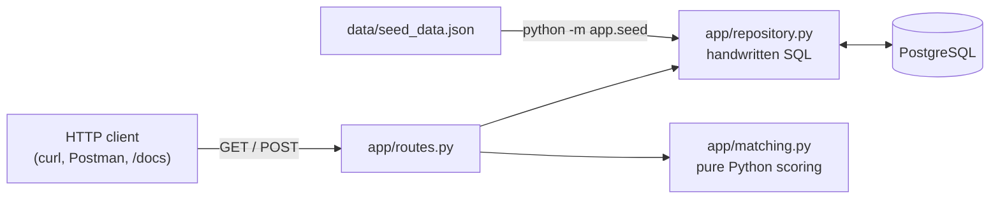
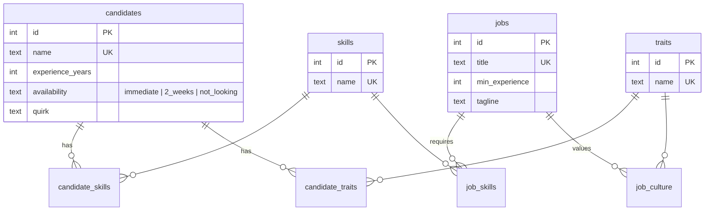
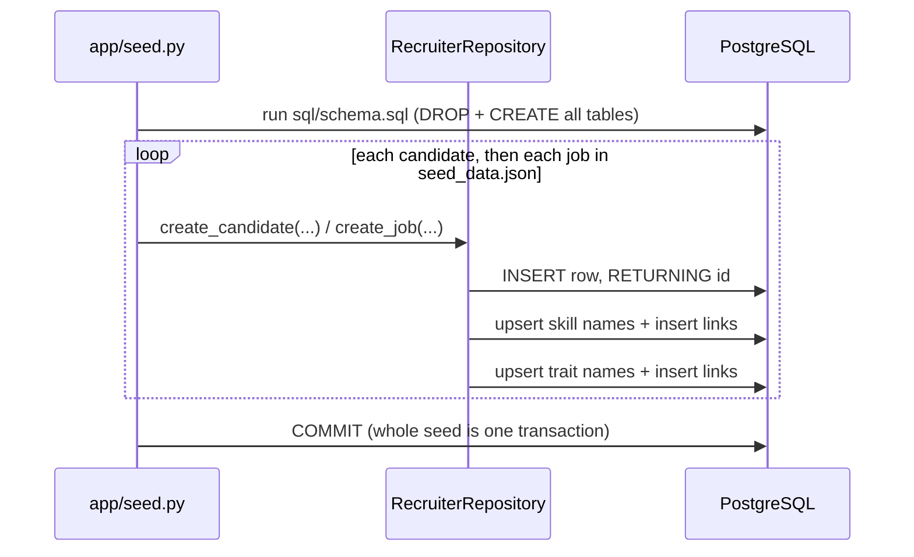
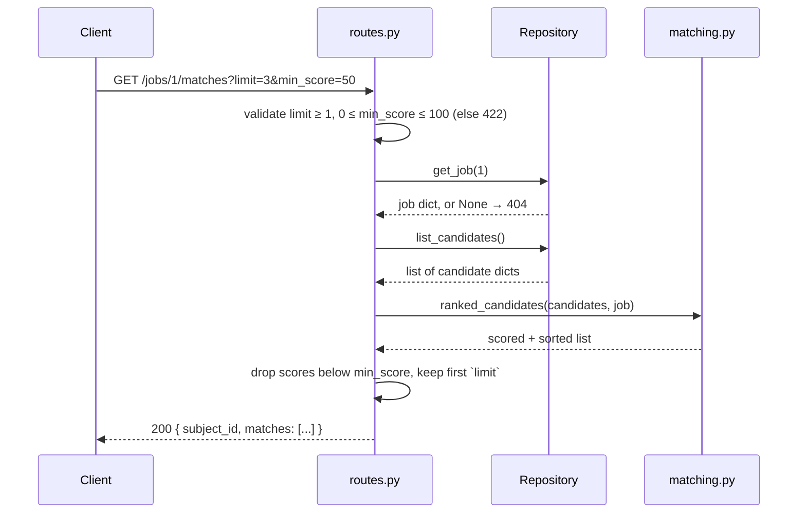

# How Recruiter Bot works

This document walks through the project end to end: how data gets in, how it is stored, what happens on each request, and how a match score is calculated. For setup commands and the reasoning behind the design choices, see the [README](../README.md).

## The big picture

Recruiter Bot is a small FastAPI service backed by PostgreSQL. It stores candidates and jobs, and on request ranks every candidate for a job (or every job for a candidate), with a score from 0 to 100 and a plain-English reason.



Two rules shape the code:

- **Raw SQL only.** Every query is written by hand in `sql/schema.sql`, `app/repository.py` and `app/seed.py`. Psycopg 3 is only the driver; there is no ORM or query builder.
- **Scoring is separate from storage.** The repository loads plain dictionaries. `app/matching.py` scores them without touching the database, which keeps the algorithm easy to read and to unit test.

## Project layout

| Path | Role |
|---|---|
| `app/main.py` | Creates the FastAPI app and registers the routes. |
| `app/routes.py` | HTTP layer: endpoints, query parameters, status codes, error mapping. |
| `app/schemas.py` | Pydantic models for request validation and response shapes. |
| `app/repository.py` | All runtime SQL: reading and creating candidates and jobs. |
| `app/matching.py` | The scoring algorithm and ranking. |
| `app/db.py` | Opens a database connection from `DATABASE_URL`. |
| `app/seed.py` | Rebuilds the schema and loads the seed data. |
| `sql/schema.sql` | Table definitions (DDL). |
| `data/seed_data.json` | The 15 candidates and 6 jobs from the assignment. |
| `sql/hiring_ops_setup.sql`, `sql/sql_detective.sql` | Part 2 of the assignment, independent of the app. |
| `tests/` | Unit, API and integration tests. |
| `scripts/` | One-command runners for the API and the SQL Detective answers. |
| `postman/` | Postman collection covering every endpoint. |
| `docker-compose.yml` | Optional local PostgreSQL. |

## Data model



- **Lookup tables.** Each skill name and each trait name is stored once, in `skills` or `traits`. Candidates and jobs point to them through join tables whose primary key is the pair of IDs, so the same skill can't be linked twice.
- **One shared vocabulary for culture.** Candidate traits and job culture keywords both use the `traits` table. "Does the candidate fit the culture?" therefore comes down to comparing trait IDs.
- **Constraints carry the rules.** Names and titles are unique, years can't be negative, and `availability` must be one of three values.
- **Matches are not stored.** Scores are computed on each request. With 15 × 6 pairs this costs nothing and is never out of date.

## Flow 1: loading data (`python -m app.seed`)



1. The schema file drops every table and recreates it. Rerunning the seed is therefore a clean rebuild, and IDs always come out the same: candidates 1–15 and jobs 1–6, in file order.
2. Each record goes through the **same repository methods the POST endpoints use**, so seeded data and API-created data are stored identically.
3. Skills and traits are linked by `link_names()`. One SQL statement turns the list into rows with `unnest`, inserts any names that don't exist yet, and links the resulting IDs to the owner row.
4. Everything runs in one transaction. If any insert fails, nothing is committed.

## Flow 2: getting matches (`GET /jobs/{id}/matches`)



- **One connection per request.** `get_repository()` is a FastAPI dependency that opens a connection for the request. It commits if the request succeeds, rolls back if it raises, and closes the connection either way.
- **Lists come back in one query.** Each candidate's skills and traits are collected with `ARRAY(SELECT ...)` subqueries, so the repository runs one query for the list rather than one query per candidate.
- **The reverse direction mirrors it.** `GET /candidates/{id}/matches` follows the same path with `get_candidate`, `list_jobs` and `ranked_jobs`.

## Flow 3: adding data (`POST /candidates`, `POST /jobs`)

1. **Validation.** Pydantic checks the body: required fields, non-negative years, an allowed availability value, at least one skill. Skill and trait names are trimmed, lowercased and de-duplicated, so `"Deduction"` and `"deduction "` become the same skill. Invalid input returns **422** and never reaches the database.
2. **Insert.** The repository inserts the row and links its skills and traits, the same way the seed does.
3. **Duplicates.** If the name or title already exists, PostgreSQL's unique constraint raises `UniqueViolation`. The route turns that into **409**, and the transaction is rolled back.
4. **Response.** The new record is read back and returned with **201**. It is immediately part of every ranking.

## The matching algorithm

`score_match(candidate, job)` in `app/matching.py` adds up four parts:

| Signal | Max points | How it's calculated |
|---|---|---|
| Skill overlap | 60 | required skills the candidate has ÷ total required skills |
| Experience | 25 | candidate years ÷ job minimum, capped at 1.0 |
| Culture fit | 10 | job culture keywords found in the candidate's traits ÷ total keywords |
| Availability | 5 | immediate = 1.0, 2 weeks = 0.5, not looking = 0 |

**Worked example: Sherlock H. for Backend Detective**

| Signal | Data | Points |
|---|---|---|
| Skills | has deduction, pattern-recognition, forensics → 3/3 | 60 |
| Experience | 8 years vs minimum 3 → capped at 1.0 | 25 |
| Culture | traits *analytical, blunt* vs culture *analytical, autonomous* → 1/2 | 5 |
| Availability | immediate | 5 |
| **Total** | | **95** |

The API returns this as:

```json
{
  "id": 1,
  "name": "Sherlock H.",
  "score": 95.0,
  "reason": "matches 3/3 required skills (deduction, forensics, pattern-recognition); has 8 years of experience (minimum 3); shares culture traits (analytical); available immediately.",
  "breakdown": {"skills": 60.0, "experience": 25.0, "culture": 5.0, "availability": 5.0}
}
```

**Ranking.** Results are sorted by:

1. score, highest first;
2. skill points, so on a tie the stronger skill match wins;
3. name or title, ignoring case;
4. ID.

The same input always gives the same order.

**Why these weights.** Skills and experience are the two criteria the brief requires, and together they carry 85 of the 100 points. Culture and availability can reorder candidates who are otherwise close, but they can't make up for missing skills. Candidates who are not looking are ranked lower rather than hidden, so a recruiter can still see and choose to approach them.

**Changing the algorithm.** The weights are the constants at the top of `app/matching.py`. Adding a new signal means:

1. compute a 0–1 ratio for it;
2. add a weight constant and a `breakdown` entry;
3. add a phrase to the `reason` sentence;
4. add a field to `ScoreBreakdown` in `app/schemas.py`.

## Errors at a glance

| Situation | Status |
|---|---|
| Success (read) | 200 |
| Record created | 201 |
| Unknown candidate or job ID | 404 |
| Duplicate candidate name or job title | 409 |
| Invalid body or query parameter | 422 |

## Part 2: SQL Detective

This part is separate from the app.

- **Setup.** `sql/hiring_ops_setup.sql` loads the hiring-ops dataset exactly as supplied.
- **Answers.** `sql/sql_detective.sql` answers the five questions, one query each, with a comment above each.
- **The trap in Q3.** Ananya Rao appears twice with different email capitalisation. The query lowercases and trims emails before grouping, so she counts as one person.
- **Where "applied" comes from.** The `applicants` table has no posting column, so the queries infer which postings someone applied to from the `interviews` table.

## Tests

Three layers, run with `pytest`:

| File | What it checks | Needs a database? |
|---|---|---|
| `tests/test_matching.py` | Scoring arithmetic, reasons, tie-breaking | No |
| `tests/test_api.py` | Routes, status codes and validation, using a fake repository | No |
| `tests/test_integration.py` | Schema, seed, real SQL and endpoints end to end | Yes; skipped if PostgreSQL isn't reachable |

The integration tests **rebuild the database** at `DATABASE_URL` and reseed it when they finish, so point them at one you don't mind resetting.
